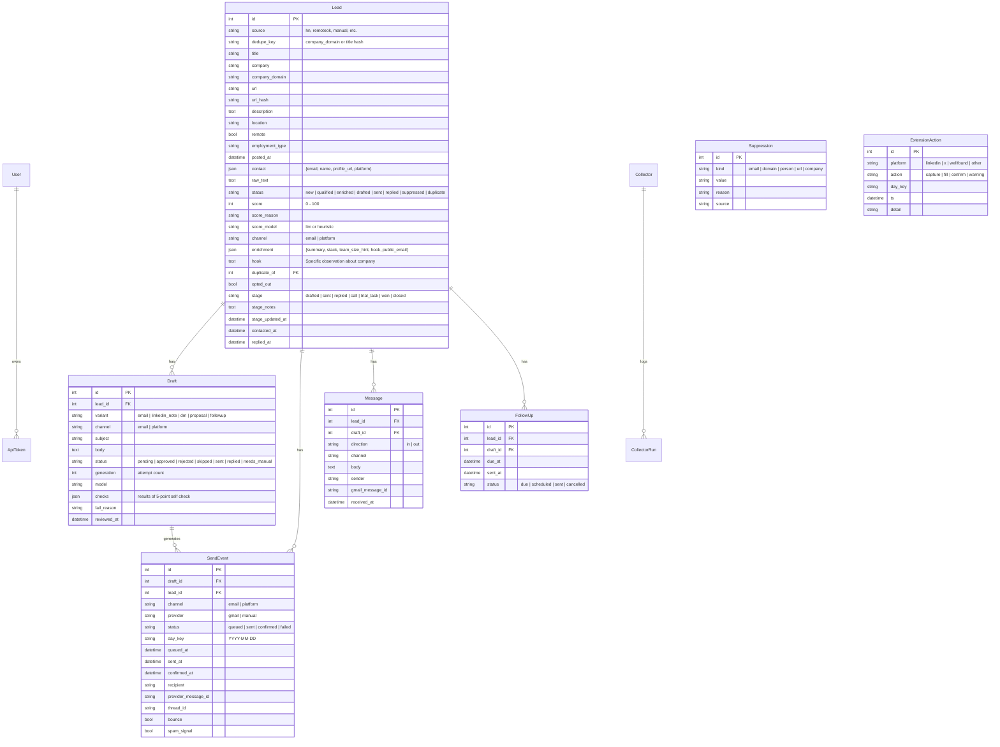
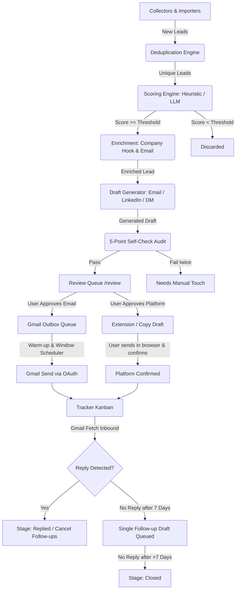

# OutreachHub — Complete OpenCode Handoff & Implementation Specification

> **Target Audience:** OpenCode / AI Coding Agent & Lead Engineer  
> **Repository:** `ai-founder-outreach`  
> **Current Date:** October 2026  
> **Status:** Steps 1 through 5 fully implemented and verified (59 pytest tests passing, frontend builds clean); Steps 6, 7, and 8 ready for immediate implementation.

---

## Table of Contents
1. [Project Mission & User Persona](#1-project-mission--user-persona)
2. [Strict Non-Negotiable Rules](#2-strict-non-negotiable-rules)
3. [Architecture & Technology Stack](#3-architecture--technology-stack)
4. [Environment Setup & Runtime Gotchas](#4-environment-setup--runtime-gotchas)
5. [Current Implementation Status (What Works Today)](#5-current-implementation-status-what-works-today)
6. [Comprehensive Database Schema](#6-comprehensive-database-schema)
7. [End-to-End Outreach Pipeline Flow](#7-end-to-end-outreach-pipeline-flow)
8. [Completed Bugfixes & Technical Findings](#8-completed-bugfixes--technical-findings)
9. [Detailed Specifications for Remaining Steps](#9-detailed-specifications-for-remaining-steps)
   - [Step 6: Tracker Kanban Board & Follow-up UI](#step-6-tracker-kanban-board--follow-up-ui)
   - [Step 7: Chrome Extension (Manifest V3 - Assisted Manual Mode)](#step-7-chrome-extension-manifest-v3---assisted-manual-mode)
   - [Step 8: Remaining Collectors, Manual Importer, Analytics & Help UI](#step-8-remaining-collectors-manual-importer-analytics--help-ui)
10. [Step-by-Step Task Checklist for OpenCode](#10-step-by-step-task-checklist-for-opencode)

---

## 1. Project Mission & User Persona

### Mission
**OutreachHub** is an autonomous intelligence & assisted-outreach platform designed to find remote part-time, contract, and early-stage AI engineering opportunities from every legitimate public source, qualifying leads and preparing hyper-personalized messages that the candidate **approves one by one**.

### Target Volume
- Collect: 300+ leads/day across sources
- Qualify: 100+ leads/day via scoring
- Queue Drafts: ~50 drafts/day
- Target Sent: 30–40 human-reviewed messages/day (within warm-up ramp)

### Candidate Persona (The "About Me" Profile)
- **Candidate:** Rohit Kumar
- **Current Role:** Software Engineer at Wipro Technologies, Bengaluru (working on GenAI, Python, and automation). BTech CSE from VIT Chennai (2025).
- **Core Strengths:** Python, LangChain, LangGraph, agentic AI (ReAct), RAG pipelines, vector databases (FAISS, ChromaDB), LLM evaluation (LLM-as-a-judge, RAGAS rubrics), prompt engineering, REST APIs.
- **Flagship Projects:**
  1. *Enterprise iFlow Document Generator:* LLM agent reading integration flows to generate Technical Specs & Design docs stored in SharePoint.
  2. *Self-Improving Agent with Automated Eval Loop:* LangGraph-based autonomous agent with iterative critique & scoring.
  3. *Ad Engagement Analysis:* Multi-task CNN (emotion/age/gender) with transfer learning, OpenCV, Flask, and React.
- **Goal:** Remote part-time or contract AI/GenAI engineering work (LLM apps, agents, RAG, evals), ideally USD-paid. Eager to start with a small paid trial task.
- **Strict Confidentiality:**
  - NEVER name the client or any Wipro-internal details.
  - Describe the enterprise project ONLY as written in the About Me block.
  - NEVER invent metrics, tools, results, titles, or employers.
  - DO NOT mention SAP.
  - NEVER claim to be unemployed or misstate work status.

---

## 2. Strict Non-Negotiable Rules

OpenCode must preserve and respect these architectural and compliance constraints in all future code:

1. **Human-in-the-Loop Approval:**  
   Every message must be reviewed and approved individually. **There is NO "Approve All" button and NO unattended background sending.**
2. **Zero Password Storage:**  
   The platform never stores, asks for, or handles passwords for LinkedIn, X (Twitter), Wellfound, or Google/Gmail. Gmail uses OAuth 2.0 with desktop app credentials.
3. **No Scraping Behind Logins:**  
   LinkedIn, X, and Wellfound are **NEVER automated or scraped**. The Chrome extension only activates on tabs the user manually navigated to in their browser, reading visible text and pasting approved drafts into the message box. The user presses "Send" themselves.
4. **Public Contact Data Only:**  
   No email guessing (e.g. `first.last@company.com`), no scraping behind paywalls or login screens. If no public email is present in the posting or public domain, the lead routes strictly to the "platform" channel.
5. **Human Pace & Warm-Up Caps:**  
   - 20-second mandatory cooldown between extension fills.
   - Email warm-up schedule: Days 1–3: max 10/day; Days 4–7: max 20/day; Days 8–14: max 30/day; Day 15+: up to 50/day.
   - Platform cap: 5–10/day rising to a hard ceiling of 25/day.
   - Auto-pause if email bounce rate exceeds 5%.
   - Send window: 09:00 to 18:00 local time with 3–8 minute randomized spacing.
6. **Suppression & Opt-Outs:**  
   Suppression table (`suppression`) is checked at every stage (ingestion, scoring, drafting, outbox). Opt-outs and "never contact" actions permanently block domains and contacts.

---

## 3. Architecture & Technology Stack

```
ai-founder-outreach/
├── backend/
│   ├── app/
│   │   ├── collectors/       # Pluggable source collectors (BaseCollector, HN, RemoteOK, WWR, Remotive, GitHub)
│   │   ├── routers/          # FastAPI APIRouters (auth, leads, review, tracker, sources, settings, extension, etc.)
│   │   ├── services/         # Business logic (scoring, dedupe, enrichment, drafting, self_check, sending, warmup, gmail)
│   │   ├── config.py         # Pydantic Settings (.env configuration)
│   │   ├── db.py             # SQLAlchemy engine, session maker, sync_columns()
│   │   ├── deps.py           # Dependency injection (get_current_user, get_db)
│   │   ├── main.py           # FastAPI entrypoint, lifespan startup, CORS, session middleware
│   │   ├── models.py         # Unified SQLAlchemy declarative models
│   │   ├── scheduler.py      # APScheduler background tasks (pipeline, outbox, replies, followups)
│   │   ├── schemas.py        # Pydantic request/response schemas
│   │   ├── security.py       # Passlib PBKDF2 hashing, API token generation
│   │   └── seed.py           # Idempotent database seeder (Profile, OnboardingItems, Settings)
│   ├── alembic/              # Database migration configs
│   ├── tests/                # Pytest suite with recorded HTTPX fixtures
│   ├── requirements.txt      # Python dependencies
│   └── sync_db.py            # SQLite schema sync utility
├── frontend/
│   ├── src/
│   │   ├── app/
│   │   │   ├── (app)/        # Authenticated app routes (/, /leads, /review, /sources, /settings, /profile, /[page])
│   │   │   ├── (auth)/login/ # Login & setup page
│   │   │   ├── globals.css   # Tailwind CSS v4 & theme variables
│   │   │   └── layout.tsx    # Root layout with ThemeProvider
│   │   ├── components/       # UI components (Shell, TagEditor, Progress, ThemeToggle, Radix UI primitives)
│   │   └── lib/              # API client (fetch wrapper with credentials), types.ts, utils
│   ├── package.json          # Next.js 16.4, React 19, Tailwind CSS v4
│   └── tsconfig.json         # TypeScript configuration
├── extension/
│   └── src/                  # Chrome Manifest V3 extension (to be populated in Step 7)
├── config/
│   └── sources.yaml          # YAML configuration for collectors (overrides code defaults)
├── docs/                     # Documentation & handoff specs
├── USER_MANUAL.md            # App user guide (rendered in /help)
└── docker-compose.yml        # Multi-container local orchestration
```

### Key Libraries
- **Backend:** FastAPI, SQLAlchemy 2.0, APScheduler, HTTPX, Cryptography (Fernet), PyPDF (resume parsing), Pydantic v2, Passlib.
- **Frontend:** Next.js 16.4 (App Router), React 19, Tailwind CSS v4, Lucide React, Radix UI, TanStack Table v8.

---

## 4. Environment Setup & Runtime Gotchas

### Python Virtual Environment (CRITICAL)
- The project has a dedicated virtualenv at `.venv/` using **Python 3.12.3**.
- **DO NOT** use the system-wide Python if it is Python 3.14 (SQLAlchemy fails on Python 3.14 typing descriptors).
- Always run backend commands with:
  ```powershell
  # Windows PowerShell
  .\.venv\Scripts\activate
  # or directly:
  .\.venv\Scripts\python.exe -m pytest
  .\.venv\Scripts\python.exe -m uvicorn app.main:app --reload --port 8000
  ```

### Database Schema Auto-Sync
- SQLite is used at `backend/data/outreach.db`.
- When models in `backend/app/models.py` are modified or columns are added, `app.db.sync_columns()` automatically runs `ALTER TABLE ... ADD COLUMN` on startup. You can also run `.\.venv\Scripts\python.exe sync_db.py`.

### Frontend Development
```powershell
cd frontend
npm install
npm run dev      # Runs on http://localhost:3000
npm run build    # Typecheck and production build
```
*Note on Next.js security advisory:* The Next.js build runs cleanly (`exit code 0`), but prints an advisory for Next.js 16.4.0. If upgraded, use standard `npm install next@latest react@latest react-dom@latest`.

---

## 5. Current Implementation Status (What Works Today)

| Component | Status | Details |
|---|---|---|
| **Single-user Auth & API Tokens** | **BUILT & TESTED** | Session-based cookie auth, first-run setup, token issuing for extension. |
| **Profile & Resume Parsing** | **BUILT & TESTED** | Profile editor with tone, do-not-mention, skills; backend `POST /api/profile/resume` parses PDF/TXT/MD with PyPDF and syncs collector search filters. |
| **Onboarding Checklist** | **BUILT & TESTED** | Live progress bar on Dashboard, auto-detection of completed steps. |
| **Core Collectors** | **BUILT & TESTED** | Hacker News (Algolia), RemoteOK, We Work Remotely, Remotive, GitHub. Caching, robots.txt check, rate limits. |
| **Leads Table & Drawer** | **BUILT & TESTED** | TanStack table, faceted search, filtering by channel/source/score/remote, lead detail drawer with history (drafts/sends/messages). |
| **Sources Page** | **BUILT & TESTED** | Toggle collectors, edit keywords/slugs/feeds, on-demand execution, run history logs. |
| **Dedupe & Scoring** | **BUILT & TESTED** | URL hash + company domain dedupe, 60-day cooldown; LLM/heuristic scoring with founder bonuses and severe senior penalties. |
| **Enrichment & Self-Check** | **BUILT & TESTED** | Public email discovery, company hook generation, channel routing (email vs platform); 5-point self-check audit. |
| **Review Queue** | **BUILT & TESTED** | Full split-screen UI, hotkeys (`A`, `E`, `S`, `R`, `N`), live draft editing, queue statistics. |
| **Gmail OAuth & Warm-up Engine** | **BUILT & TESTED** | OAuth 2.0 flow, Fernet token encryption, outbox queuing, warm-up ramping (10->20->30->50), send window, spacing, bounce auto-pause. |
| **Tracker (Backend)** | **BUILT & TESTED** | `GET /api/tracker` and `POST /api/tracker/{lead_id}` implemented. |
| **Tracker (Frontend)** | **PENDING (Step 6)** | Needs Kanban board UI at `/tracker`. |
| **Chrome Extension (Backend)** | **BUILT & TESTED** | `backend/app/routers/extension.py` with `/ping`, `/capture`, `/status`, `/pending`, `/fill-log`, `/confirm`, `/warning`. |
| **Chrome Extension (Extension Files)** | **PENDING (Step 7)** | `extension/src` is currently empty. |
| **Analytics (Backend)** | **BUILT & TESTED** | `GET /api/analytics` returns source rankings, reply rates, score band conversions, weekly breakdown. |
| **Analytics (Frontend)** | **PENDING (Step 8)** | Needs Analytics dashboard UI at `/analytics`. |
| **Help (Backend)** | **BUILT & TESTED** | `GET /api/help` renders `USER_MANUAL.md` with section breakdown. |
| **Help (Frontend)** | **PENDING (Step 8)** | Needs in-app searchable reader UI at `/help`. |
| **Manual Importer (Backend)** | **BUILT & TESTED** | `POST /api/import/text` and `POST /api/import/csv` implemented. |
| **Manual Importer (Frontend)** | **PENDING (Step 8)** | Needs modal or tab in `/leads` for paste/CSV upload. |
| **Additional Collectors** | **PENDING (Step 8)** | Remaining 15+ sources in `backend/app/collectors/registry.py`. |

---

## 6. Comprehensive Database Schema

All models live in [backend/app/models.py](file:///c:/Users/rohit/code/ai-founder-outreach/backend/app/models.py):



---

## 7. End-to-End Outreach Pipeline Flow



---

## 8. Completed Bugfixes & Technical Findings

During the initial code audit, the following fixes and validations were performed:

1. **Fixed Missing Imports in `profile.py`:**
   - [backend/app/routers/profile.py:L3](file:///c:/Users/rohit/code/ai-founder-outreach/backend/app/routers/profile.py#L3): Missing `File` and `UploadFile` from FastAPI caused `NameError: name 'File' is not defined` when loading router modules.
   - **Resolution:** Added `File, UploadFile` to `from fastapi import ...`. All 59 tests now pass cleanly.
2. **Dynamic Column Synchronization:**
   - Both `app.db.sync_columns()` and standalone `sync_db.py` exist to automatically patch SQLite tables when models gain new attributes, ensuring migrations never block local dev.
3. **Frontend Production Build:**
   - Verified Next.js 16.4 production build: static page generation and TypeScript typechecking pass with 0 errors.

---

## 9. Detailed Specifications for Remaining Steps

### Step 6: Tracker Kanban Board & Follow-up UI

#### Backend Status: **Ready & Tested**
- Endpoints live:
  - `GET /api/tracker` returns `{ "columns": [ { "key": "drafted" | "sent" | "replied" | "call" | "trial_task" | "won" | "closed", "cards": CardOut[] } ] }`
  - `POST /api/tracker/{lead_id}` with `{ stage?: string, notes?: string }` updates lead stage and appends notes.
- Inbound detection:
  - `backend/app/services/gmail.py:fetch_replies` pulls new inbound messages from Gmail API.
  - `backend/app/services/followups.py:apply_inbound_messages` automatically marks leads as `replied` and cancels pending follow-ups.
  - `backend/app/services/followups.py:process_followups` automatically queues a single follow-up draft after 7 days of silence, and moves to `closed` after 14 days total.

#### Frontend Work Required:
Create [frontend/src/app/(app)/tracker/page.tsx](file:///c:/Users/rohit/code/ai-founder-outreach/frontend/src/app/%28app%29/tracker/page.tsx) to replace the `[page]` placeholder:
1. **Kanban Board Layout:**
   - Columns: `Drafted`, `Sent`, `Replied`, `Call`, `Trial Task`, `Won`, `Closed`.
   - Distinct badges / accent colors per column (e.g., emerald for Won, amber for Trial Task, purple for Replied).
2. **Card Content:**
   - Candidate / Lead title and Company name.
   - Channel badge (`email` vs `platform`), Source badge (`hn`, `remoteok`, `manual`, etc.), Score badge.
   - Relative timestamps: "Contacted 3d ago", "Replied yesterday".
   - Expandable / editable quick notes textarea that debounces or saves on blur to `POST /api/tracker/{lead_id}`.
   - Action controls: "Move to Next Stage" button or drag-and-drop between columns.
   - Direct link to original job posting / profile URL.
3. **Card Drawer / Modal:**
   - Clicking a card opens full context: original posting, message history (outbound + inbound messages from `GET /api/leads/{id}/history`), and follow-up status.

---

### Step 7: Chrome Extension (Manifest V3 - Assisted Manual Mode)

#### Backend Status: **Ready & Tested**
- `backend/app/routers/extension.py` is fully wired:
  - `GET /api/extension/ping` — verifies Bearer token.
  - `POST /api/extension/capture` — receives `{ platform, url, name, headline, company, post_text }` and creates/upserts a lead.
  - `GET /api/extension/status?platform=...` — returns `{ cap, used, remaining, seconds_until_next_fill, paused_until, min_fill_interval_seconds: 20 }`.
  - `GET /api/extension/pending?platform=...&url=...` — returns the approved draft waiting to be sent on this platform/URL.
  - `POST /api/extension/fill-log` — checks human pace (20s gate, daily cap) and logs action.
  - `POST /api/extension/confirm` — logs that user pressed Send, moves lead stage to `sent`.
  - `POST /api/extension/warning` — user flags a captcha or restriction notice, auto-pausing platform for 24h.

#### Extension Implementation Required:
Populate `extension/src/`:
1. `manifest.json`:
   - Manifest V3.
   - Name: "OutreachHub Assistant".
   - Permissions: `storage`, `activeTab`, `scripting`.
   - Host permissions: `http://localhost:8000/*`, `https://*.linkedin.com/*`, `https://*.twitter.com/*`, `https://*.x.com/*`, `https://*.wellfound.com/*`.
   - Action popup: `popup.html`.
2. `popup.html` & `popup.js`:
   - Settings tab / screen: Paste API Token (issued from `/settings` or `/api/tokens`) and OutreachHub API URL (`http://localhost:8000`).
   - Main screen:
     - Header: Connection status indicator, platform detected (LinkedIn, X, Wellfound, Other), Daily Cap counter (`X / 25 used today`).
     - Cooldown timer: Displays remaining seconds if under the 20-second human pace limit.
     - Action 1: **"Capture Page / Save Lead"** — sends message to content script to scrape visible text on currently open tab and posts to `/api/extension/capture`.
     - Action 2: **"Fill Draft"** — fetches pending approved draft for this lead/URL via `/api/extension/pending`, invokes `/api/extension/fill-log`, and messages content script to inject the text into the active messaging input box.
     - Action 3: **"Confirm Sent"** — records that the user pressed send themselves via `/api/extension/confirm`.
     - Safety Button: **"Report Captcha / Restrict"** — instantly calls `/api/extension/warning` to pause the platform for 24 hours.
3. Content Scripts (`content.js`):
   - DOM parsers for visible fields:
     - *LinkedIn:* Extract name from `h1.text-heading-xlarge` or post author, headline, company name, profile URL.
     - *X / Twitter:* Extract handle, display name, bio or tweet text.
     - *Wellfound:* Extract startup name, job title, founder/recruiter name.
   - Text injector: Finds message textarea or `contenteditable` container (e.g. LinkedIn message box) and inserts text safely using `document.execCommand('insertText')` or input event dispatching so framework state updates naturally. **NEVER auto-click the Send button.**

---

### Step 8: Remaining Collectors, Manual Importer, Analytics & Help UI

#### 1. Extra Collectors (`backend/app/collectors/`):
Expand [backend/app/collectors/registry.py](file:///c:/Users/rohit/code/ai-founder-outreach/backend/app/collectors/registry.py) by populating `EXTRA_COLLECTORS`:
- **Remote Job Boards:**
  - `HimalayasCollector`: Public API (`https://himalayas.app/jobs/api`).
  - `JobicyCollector`: Public feed (`https://jobicy.com/api/v2/remote-jobs`).
  - `ArbeitnowCollector`: Public API (`https://www.arbeitnow.com/api/job-board-api`).
  - `WorkingNomadsCollector`: Public API (`https://www.workingnomads.com/api/exposed_jobs/`).
  - `AiJobsCollector`: Public feed for `ai-jobs.net`.
- **ATS Public Boards:**
  - `GreenhouseCollector`: `https://boards-api.greenhouse.io/v1/boards/{slug}/jobs` for configured company slugs.
  - `LeverCollector`: `https://api.lever.co/v0/postings/{slug}`.
  - `AshbyCollector`: `https://api.ashbyhq.com/posting-api/job-board/{slug}`.
- **Developer Communities & Curations:**
  - `RedditCollector`: Reddit JSON / official API for `r/forhire`, `r/freelance_forhire`, `r/remote_jobs`.
  - `DevToCollector`: Public API (`https://dev.to/api/articles?tag=job`).
  - `LobstersCollector`: RSS feed (`https://lobste.rs/t/hiring.rss`).
  - `YCDirectoryCollector`: Public directory listing for YC founders / hiring companies.
- **Search-Dorks API:**
  - `SearchDorkCollector`: Queries Brave Search API or SerpAPI with dorks defined in `config/sources.yaml` (e.g. `site:lever.co "AI Engineer" "part-time"`).

#### 2. Manual Importer UI:
- Add a "Manual Import" button and modal on [frontend/src/app/(app)/leads/page.tsx](file:///c:/Users/rohit/code/ai-founder-outreach/frontend/src/app/%28app%29/leads/page.tsx):
  - **Text Mode:** Multiline textarea accepting lines formatted as `Title | Company | URL` or raw job posting text, calling `POST /api/import/text`.
  - **CSV Mode:** Drag-and-drop CSV file upload calling `POST /api/import/csv` with column preview.
  - Shows instant import summary: `X created, Y duplicates, Z suppressed`.

#### 3. Analytics Dashboard ([frontend/src/app/(app)/analytics/page.tsx](file:///c:/Users/rohit/code/ai-founder-outreach/frontend/src/app/%28app%29/analytics/page.tsx)):
- Consumes `GET /api/analytics?days=30`:
  - **KPI Cards:** Total Sent, Total Replies, Overall Reply Rate %, Positive Reply Rate %.
  - **Source Ranking Table:** Sources ordered by reply rate, sent volume, and positive responses (with advice on which top 2-3 sources to double down on and which <1% sources to disable).
  - **Channel Breakdown:** Email vs Platform conversion comparison.
  - **Score Band Performance:** Conversion rate by score tiers (`81-100`, `61-80`, `41-60`, `0-40`).
  - **Variant Performance:** Comparison between Email, LinkedIn connection note, and DM.
  - **Weekly Trend:** 4-week bar or line chart of outbound vs replies.
  - **System Recommendation:** Formatted callout box with actionable tactical advice generated by `_recommendation()`.

#### 4. In-App Help Page ([frontend/src/app/(app)/help/page.tsx](file:///c:/Users/rohit/code/ai-founder-outreach/frontend/src/app/%28app%29/help/page.tsx)):
- Consumes `GET /api/help`:
  - Search input filtering manual sections in real-time.
  - Sidebar table of contents linking directly to H2/H3 headers.
  - Markdown rendered view of `USER_MANUAL.md`.

#### 5. Dashboard Live Data Polish:
- Update [frontend/src/app/(app)/page.tsx](file:///c:/Users/rohit/code/ai-founder-outreach/frontend/src/app/%28app%29/page.tsx) to fetch `GET /api/stats/dashboard`:
  - Replace static `FUNNEL` array with live counts (`collected`, `qualified`, `drafted`, `sent`, `replied`).
  - Replace static `Warm-up & caps` numbers with live `warmup` and `platform_warmup` status.
  - Replace static `Reply rate by source` card with top sources from `reply_rate_by_source`.

#### 6. Profile Resume Upload UI:
- Update [frontend/src/app/(app)/profile/page.tsx](file:///c:/Users/rohit/code/ai-founder-outreach/frontend/src/app/%28app%29/profile/page.tsx):
  - Add file upload input (accepting `.pdf`, `.txt`, `.md`) sending a multipart POST to `/api/profile/resume`.
  - Display parsed confirmation, auto-extracted skills, and notify user that collector search filters were synchronized.

---

## 10. Step-by-Step Task Checklist for OpenCode

When beginning work on this codebase, OpenCode should execute in this staged sequence:

### Phase 1: Step 6 Completion (Tracker & Follow-ups)
- [ ] Create `frontend/src/app/(app)/tracker/page.tsx` with a responsive 7-column Kanban board (`drafted`, `sent`, `replied`, `call`, `trial_task`, `won`, `closed`).
- [ ] Connect `GET /api/tracker` to fetch columns and cards.
- [ ] Implement stage transition controls calling `POST /api/tracker/{lead_id}` with `{ stage: newStage }`.
- [ ] Implement in-place notes editing for cards saving to `POST /api/tracker/{lead_id}` with `{ notes: newNotes }`.
- [ ] Add card click drawer showing lead posting details, message history, and direct link.
- [ ] Test Kanban transitions in browser and verify follow-up scheduler operations.

### Phase 2: Step 7 Completion (Chrome Extension)
- [ ] Create `extension/src/manifest.json` with MV3 permissions and content script declarations.
- [ ] Create `extension/src/popup.html` and `extension/src/popup.js` with API token configuration, status polling, and human-pace timer.
- [ ] Create content scripts (`content_linkedin.js`, `content_x.js`, `content_wellfound.js` or unified `content.js`) for DOM parsing and draft pasting.
- [ ] Wire popup actions to `POST /api/extension/capture`, `GET /api/extension/pending`, `POST /api/extension/fill-log`, `POST /api/extension/confirm`, and `POST /api/extension/warning`.
- [ ] Verify 20-second cooldown gate and restriction pause handling.

### Phase 3: Step 8 Completion (Analytics, Importer, Help & Remaining Collectors)
- [ ] Build `frontend/src/app/(app)/analytics/page.tsx` displaying KPI metrics, source ranking, score band conversion, and system recommendations from `GET /api/analytics`.
- [ ] Build `frontend/src/app/(app)/help/page.tsx` with search and rendered sections from `GET /api/help`.
- [ ] Add Manual Import modal (text & CSV) to `frontend/src/app/(app)/leads/page.tsx` calling `POST /api/import/text` and `POST /api/import/csv`.
- [ ] Wire live stats on `frontend/src/app/(app)/page.tsx` using `GET /api/stats/dashboard`.
- [ ] Add resume file upload button in `frontend/src/app/(app)/profile/page.tsx` calling `POST /api/profile/resume`.
- [ ] Implement remaining collectors in `backend/app/collectors/` and register in `EXTRA_COLLECTORS` (Himalayas, Jobicy, Arbeitnow, ATS boards, Reddit, Search Dorks).
- [ ] Run full test suite (`.\.venv\Scripts\python.exe -m pytest`) and frontend build (`npm run build`).
- [ ] Update `USER_MANUAL.md` status table to mark all areas as "Built".
